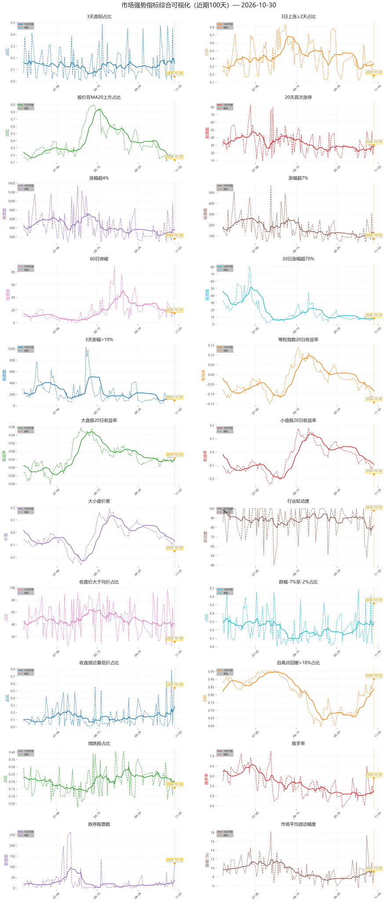

# 市场指标AI分析报告

> **摘要**：16个指标中7个短期下行、2个处历史低位；符合条件的关联指标对17对（共120对）；2个指标处历史低位（<10%分位），关注底部转折信号

## 一、指标说明
共分析了 22 个市场指标，分为以下几类：

### 1. 市场情绪指标（3个）
- 3天首阳占比：3天内首次上涨的股票比例，反映市场短期情绪
- 3日上涨≥2天占比：3天内至少2天上涨的股票比例，反映市场持续性
- 股价在MA20上方占比：股价位于20日均线之上的股票比例，反映中期趋势

### 2. 活跃度指标（2个）
- 20天首次涨停：20天内首次涨停的股票数量，反映市场活跃度
- 收盘价大于均价占比：全部股票中收盘价大于均价（成交额/成交量）的股票数量占比，反映市场资金流向

### 3. 涨幅指标（5个）
- 涨幅超4%：单日涨幅超过4%的股票数量
- 涨幅超7%：单日涨幅超过7%的股票数量
- 60日突破：突破60日高点的股票数量
- 20日涨幅超70%：20日累计涨幅超过70%的股票数量
- 3天涨幅>10%：3日累计涨幅超过10%的股票数量

### 4. 下跌指标（4个）
- 跌幅-7%至-2%占比：跌幅在-7%至-2%之间的股票比例
- 收盘接近最低价占比：收盘价与当日最低价之差不足振幅10%的股票比例
- 自高点回撤>10%占比：收盘价自高点回撤超过10%的股票比例
- 微跌股占比：跌幅介于-2%至-0.5%的股票比例

### 5. 交易指标（3个）
- 换手率：全市场平均换手率%（仅从此处移到独立分类）
- 跌停股票数：跌停股票数量
- 市场平均波动幅度：全市场 ((H-O)+(H-L)+(C-L))/prev_C 的截面对均值 (%)，反映日多空博弈活跃度

**分析目的**：当日新出现多个转折点时，可以相互印证3日上涨≥2天占比的走向

## 二、转折点重合度分析
以下是基于转折点重合度和皮尔逊相关系数的指标对分析（重合度 > 0.3 或 abs（皮尔逊相关系数）> 0.5）：

**相关性分析汇总**：

- **总指标对数**: 120 对
- **符合条件指标对数**: 17 对（重合度 > 0.3 或 abs（皮尔逊相关系数）> 0.5）

**按相关强度分类**：
- 弱相关: 15 对
- 强相关: 1 对
- 中等相关: 1 对

**按相关方向分类**：
- 正相关（同向变化）: 12 对
- 负相关（反向变化）: 5 对

**重点关注：与'3日上涨≥2天占比'相关的指标对**（共 5 对）：

- 3天首阳占比 ↔ 3日上涨≥2天占比: 重合度=0.064, 相关系数=-0.560, 方向=负相关（反向变化）
- 3日上涨≥2天占比 ↔ 股价在MA20上方占比: 重合度=0.113, 相关系数=0.531, 方向=正相关（同向变化）
- 3日上涨≥2天占比 ↔ 3天涨幅>10%: 重合度=0.170, 相关系数=0.563, 方向=正相关（同向变化）
- 3日上涨≥2天占比 ↔ 收盘价大于均价占比: 重合度=0.129, 相关系数=0.537, 方向=正相关（同向变化）
- 3日上涨≥2天占比 ↔ 跌幅-7%至-2%占比: 重合度=0.117, 相关系数=-0.641, 方向=负相关（反向变化）

## 三、市场指标可视化

---

## 四、趋势与转折点分析

生成时间: 2026-10-13 17:15:36

**仪表盘**：共 16 个指标，2 个处历史低位（分位<10%），7 个短期下行，1 个处 0-5% 极端分位。

### 1. 关键转折点识别

最近2个交易日出现重要转折点的指标：

**收盘接近最低价占比** 📉
- 日期: 2026-10-08
- 类型: 顶部转折点
- 相对位置:  (57%分位)

**跌停股票数** 📉
- 日期: 2026-10-08
- 类型: 顶部转折点
- 相对位置:  (17%分位)

**市场平均波动幅度** 📈
- 日期: 2026-10-08
- 类型: 底部转折点
- 相对位置:  (16%分位)

**3日上涨≥2天占比** 📈
- 日期: 2026-10-09
- 类型: 底部转折点
- 相对位置:  (15%分位)

**60日突破** 📈
- 日期: 2026-10-09
- 类型: 底部转折点
- 相对位置:  (23%分位)

**3天涨幅>10%** 📈
- 日期: 2026-10-09
- 类型: 底部转折点
- 相对位置:  (2%分位)

**3天首阳占比** 📉
- 日期: 2026-10-12
- 类型: 顶部转折点
- 相对位置:  (70%分位)

**股价在MA20上方占比** 📈
- 日期: 2026-10-12
- 类型: 底部转折点
- 相对位置:  (25%分位)

**收盘接近最低价占比** 📈
- 日期: 2026-10-12
- 类型: 底部转折点
- 相对位置:  (41%分位)

**自高点回撤>10%占比** 📉
- 日期: 2026-10-12
- 类型: 顶部转折点
- 相对位置:  (50%分位)

### 转折点时间聚集分析

分析多个指标是否在同一时间段出现转折点：

**转折点聚集日期**（同一天出现多个转折点）：

- **2026-10-08**: 8个指标出现转折点
  - 20天首次涨停 📈 (底部转折点)
  - 涨幅超4% 📈 (底部转折点)
  - 涨幅超7% 📈 (底部转折点)
  - 收盘价大于均价占比 📈 (底部转折点)
  - 跌幅-7%至-2%占比 📉 (顶部转折点)
  - 收盘接近最低价占比 📉 (顶部转折点)
  - 跌停股票数 📉 (顶部转折点)
  - 市场平均波动幅度 📈 (底部转折点)
  - **冲突性判断**: ⚠️ 存在冲突（5个底部转折点，3个顶部转折点）
    - 市场含义：部分指标显示见底回升信号，部分指标显示见顶回落信号，市场方向不明确，建议观望等待信号明确

- **2026-10-09**: 3个指标出现转折点
  - 3日上涨≥2天占比 📈 (底部转折点)
  - 60日突破 📈 (底部转折点)
  - 3天涨幅>10% 📈 (底部转折点)
  - **冲突性判断**: ✅ 无冲突（3个底部转折点）
    - 市场含义：多个指标同时出现底部转折点，可能预示市场即将反弹，可考虑逢低布局

- **2026-10-12**: 4个指标出现转折点
  - 3天首阳占比 📉 (顶部转折点)
  - 股价在MA20上方占比 📈 (底部转折点)
  - 收盘接近最低价占比 📈 (底部转折点)
  - 自高点回撤>10%占比 📉 (顶部转折点)
  - **冲突性判断**: ⚠️ 存在冲突（2个底部转折点，2个顶部转折点）
    - 市场含义：部分指标显示见底回升信号，部分指标显示见顶回落信号，市场方向不明确，建议观望等待信号明确

**总体市场含义**：多个指标在同一时间段出现转折点，可能预示市场趋势的重要转折点，需要密切关注。

### 2. 趋势分析

按类别分析各指标的趋势状态（相对历史位置）：

**说明**：
- **趋势强度**：基于线性回归的R²值（决定系数），范围0-100%，数值越大表示趋势越稳定可靠
- **相对位置**：基于历史转折点值计算的分位数（转折点数量≥3时），显示当前值在转折点值区间中的位置；若转折点数量不足，则基于全部历史数据计算

### 市场情绪指标

| 指标 | 最新值 | 相对位置 | 短期趋势 | 强度 |
|:---|---:|:---|:---|---:|
| 3天首阳占比 | 12.96% | 🟢 中低位 47%分位·152拐点 | 下降 | 11% |
| 3日上涨≥2天占比 | 38.22% | 🟢 中低位 29%分位·81拐点 | 上升 | 83% |
| 股价在MA20上方占比 | 33.50% | 🟢 中低位 25%分位·58拐点 | 下降 | 34% |
| 20天首次涨停 | 26.8 | 🟢 中低位 22%分位·137拐点 | 上升 | 89% |

### 涨幅指标

| 指标 | 最新值 | 相对位置 | 短期趋势 | 强度 |
|:---|---:|:---|:---|---:|
| 涨幅超4% | 277.4 | 🔵 低位 14%分位·137拐点 | 上升 | 79% |
| 涨幅超7% | 103.2 | 🔵 低位 13%分位·135拐点 | 上升 | 75% |
| 60日突破 | 25.4 | 🟢 中低位 24%分位·80拐点 | 上升 | 37% |
| 20日涨幅超70% | 7.8 | 🔵 低位 4%分位·69拐点 ⚠ 极端 | 下降 | 83% |
| 3天涨幅>10% | 116.4 | 🔵 低位 6%分位·80拐点 | 上升 | 0% |

### 下跌指标

| 指标 | 最新值 | 相对位置 | 短期趋势 | 强度 |
|:---|---:|:---|:---|---:|
| 跌幅-7%至-2%占比 | 22.30% | 🟢 中低位 48%分位·125拐点 | 下降 | 23% |
| 收盘接近最低价占比 | 13.63% | 🟢 中低位 38%分位·140拐点 | 下降 | 60% |
| 自高点回撤>10%占比 | 67.86% | 🟡 中位 51%分位·67拐点 | 上升 | 3% |
| 微跌股占比 | 23.94% | 🟡 中位 60%分位·135拐点 | 下降 | 61% |

### 交易指标

| 指标 | 最新值 | 相对位置 | 短期趋势 | 强度 |
|:---|---:|:---|:---|---:|
| 跌停股票数 | 15 | 🔵 低位 11%分位·123拐点 | 下降 | 82% |
| 市场平均波动幅度 | 9.2 | 🟢 中低位 46%分位·139拐点 | 上升 | 92% |

**图例**：🔴 ≥90%分位（高位）｜🟠 80-89｜🟡 50-79（中位）｜🟢 20-49（中低位）｜🔵 <20%（低位）；强度 = 5日线性回归 R²。

---

## 五、AI深度分析

AI分析失败：无法获取免费模型或分析超时。

建议：
1. 检查网络连接是否正常
2. 稍后重试分析
3. 手动查看指标数据和转折点分析结果
