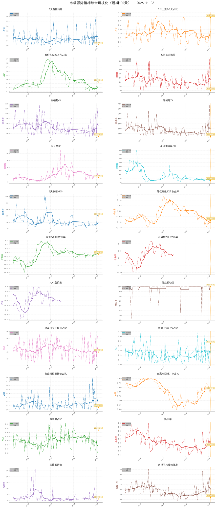

# 市场指标AI分析报告

> **摘要**：入榜 16/22 个指标中7个短期下行、8个处历史低位；校正后显著关联指标对60对（共120对，Bonferroni 校正）；8个指标处历史低位（<10%分位），关注底部转折信号

---

## 一、指标说明

共计算 22 个市场指标（趋势/相关性分析入榜 16 个，按数据完整性筛选），分为以下几类：

### 1. 市场情绪指标（3个）

- 3天首阳占比：3天内首次上涨的股票比例，反映市场短期情绪
- 3日上涨≥2天占比：3天内至少2天上涨的股票比例，反映市场持续性
- 股价在MA20上方占比：股价位于20日均线之上的股票比例，反映中期趋势

### 2. 活跃度指标（2个）

- 20天首次涨停：20天内首次涨停的股票数量，反映市场活跃度
- 收盘价大于均价占比：全部股票中收盘价大于均价（成交额/成交量）的股票数量占比，反映市场资金流向

### 3. 涨幅指标（5个）

- 涨幅超4%：单日涨幅超过4%的股票数量
- 涨幅超7%：单日涨幅超过7%的股票数量
- 60日突破：突破60日高点的股票数量
- 20日涨幅超70%：20日累计涨幅超过70%的股票数量
- 3天涨幅>10%：3日累计涨幅超过10%的股票数量

### 4. 下跌指标（4个）

- 跌幅-7%至-2%占比：跌幅在-7%至-2%之间的股票比例
- 收盘接近最低价占比：收盘价与当日最低价之差不足振幅10%的股票比例
- 自高点回撤>10%占比：收盘价自高点回撤超过10%的股票比例
- 微跌股占比：跌幅介于-2%至-0.5%的股票比例

### 5. 交易指标（3个）

- 换手率：全市场平均换手率%（仅从此处移到独立分类）
- 跌停股票数：跌停股票数量
- 市场平均波动幅度：全市场 ((H-O)+(H-L)+(C-L))/prev_C 的截面对均值 (%)，反映日多空博弈活跃度

### 6. 市场结构与轮动指标（5个）

- 等权指数20日收益率：全市场等权组合近20日收益，反映整体赚钱效应
- 大盘股20日收益率：大市值组近20日收益
- 小盘股20日收益率：小市值组近20日收益
- 大小盘价差：小盘组收益减大盘组收益，正=小盘占优
- 行业轮动度：行业间收益离散度，高=资金在行业间轮动

**分析目的**：当日新出现多个转折点时，可以相互印证3日上涨≥2天占比的走向

---

## 二、转折点重合度分析

以下是基于转折点重合度和皮尔逊相关系数的指标对分析。
**显著性口径**：16 个指标两两组合共 120 对，逐对检验会产生大量假阳性（α=0.05 下期望假阳性 6 对），故采用 **Bonferroni 校正**——阈值随样本量 N 与比较次数 m 动态推导为 `|r| > z(1-α/2m)/√N`，而非固定写死 0.5。下表只列**校正后仍显著**的指标对。

**相关性分析汇总**：

- **总指标对数**: 120 对
- **校正后显著**: 60 对
- **名义显著但校正后不显著**: 19 对（多重比较假阳性风险，不作为结论依据）

**按相关强度分类**：

- 中等相关: 28 对
- 弱相关: 17 对
- 强相关: 13 对
- 极强相关: 2 对

**按相关方向分类**：

- 正相关（同向变化）: 31 对
- 负相关（反向变化）: 28 对
- 中性相关: 1 对

**重点关注：与'3日上涨≥2天占比'相关的指标对**（共 11 对）：

- 3天首阳占比 ↔ 3日上涨≥2天占比: 重合度=0.064, 相关系数=-0.548, 方向=负相关（反向变化）
- 3日上涨≥2天占比 ↔ 股价在MA20上方占比: 重合度=0.154, 相关系数=0.498, 方向=正相关（同向变化）
- 3日上涨≥2天占比 ↔ 20天首次涨停: 重合度=0.146, 相关系数=0.355, 方向=正相关（同向变化）
- 3日上涨≥2天占比 ↔ 涨幅超4%: 重合度=0.131, 相关系数=0.430, 方向=正相关（同向变化）
- 3日上涨≥2天占比 ↔ 涨幅超7%: 重合度=0.097, 相关系数=0.356, 方向=正相关（同向变化）
- 3日上涨≥2天占比 ↔ 60日突破: 重合度=0.160, 相关系数=0.271, 方向=正相关（同向变化）
- 3日上涨≥2天占比 ↔ 3天涨幅>10%: 重合度=0.183, 相关系数=0.600, 方向=正相关（同向变化）
- 3日上涨≥2天占比 ↔ 收盘价大于均价占比: 重合度=0.129, 相关系数=0.515, 方向=正相关（同向变化）
- 3日上涨≥2天占比 ↔ 跌幅-7%至-2%占比: 重合度=0.104, 相关系数=-0.669, 方向=负相关（反向变化）
- 3日上涨≥2天占比 ↔ 收盘接近最低价占比: 重合度=0.090, 相关系数=-0.468, 方向=负相关（反向变化）
- 3日上涨≥2天占比 ↔ 跌停股票数: 重合度=0.146, 相关系数=-0.269, 方向=负相关（反向变化）

---

## 三、市场指标可视化

---

## 四、趋势与转折点分析

生成时间: 2026-11-07 21:03:28

**数据截止日**: 2026-11-06

**仪表盘**：共 16 个指标，8 个处历史低位（分位<10%），7 个短期下行，5 个处 0-5% 极端分位。

### 1. 关键转折点识别

最近2个交易日出现重要转折点的指标：

**跌停股票数** 📈

- 日期: 2026-11-04
- 类型: 底部转折点
- 相对位置:  (34%分位)

**市场平均波动幅度** 📉

- 日期: 2026-11-04
- 类型: 顶部转折点
- 相对位置:  (71%分位)

**涨幅超4%** 📈

- 日期: 2026-11-05
- 类型: 底部转折点
- 相对位置:  (100%分位)

**60日突破** 📈

- 日期: 2026-11-05
- 类型: 底部转折点
- 相对位置:  (12%分位)

**收盘价大于均价占比** 📈

- 日期: 2026-11-05
- 类型: 底部转折点
- 相对位置:  (74%分位)

**跌幅-7%至-2%占比** 📉

- 日期: 2026-11-05
- 类型: 顶部转折点
- 相对位置:  (34%分位)

**收盘接近最低价占比** 📉

- 日期: 2026-11-05
- 类型: 顶部转折点
- 相对位置:  (29%分位)

**微跌股占比** 📉

- 日期: 2026-11-05
- 类型: 顶部转折点
- 相对位置:  (1%分位)

**跌停股票数** 📉

- 日期: 2026-11-05
- 类型: 顶部转折点
- 相对位置:  (25%分位)

**市场平均波动幅度** 📈

- 日期: 2026-11-05
- 类型: 底部转折点
- 相对位置:  (90%分位)

### 转折点时间聚集分析

分析多个指标是否在同一时间段出现转折点：

**转折点聚集日期**（同一天出现多个转折点）：

- **2026-11-02**: 11个指标出现转折点
    - 3天首阳占比 📈 (底部转折点)
    - 20天首次涨停 📈 (底部转折点)
    - 涨幅超4% 📈 (底部转折点)
    - 涨幅超7% 📈 (底部转折点)
    - 20日涨幅超70% 📈 (底部转折点)
    - 收盘价大于均价占比 📈 (底部转折点)
    - 跌幅-7%至-2%占比 📉 (顶部转折点)
    - 收盘接近最低价占比 📉 (顶部转折点)
    - 微跌股占比 📉 (顶部转折点)
    - 跌停股票数 📉 (顶部转折点)
    - 市场平均波动幅度 📈 (底部转折点)
    - **冲突性判断**: ⚠️ 存在冲突（7个底部转折点，4个顶部转折点）
        - 市场含义：部分指标显示见底回升信号，部分指标显示见顶回落信号，市场方向不明确，建议观望等待信号明确

- **2026-11-03**: 6个指标出现转折点
    - 3日上涨≥2天占比 📈 (底部转折点)
    - 股价在MA20上方占比 📈 (底部转折点)
    - 60日突破 📈 (底部转折点)
    - 3天涨幅>10% 📈 (底部转折点)
    - 自高点回撤>10%占比 📉 (顶部转折点)
    - 微跌股占比 📈 (底部转折点)
    - **冲突性判断**: ⚠️ 存在冲突（5个底部转折点，1个顶部转折点）
        - 市场含义：部分指标显示见底回升信号，部分指标显示见顶回落信号，市场方向不明确，建议观望等待信号明确

- **2026-11-04**: 9个指标出现转折点
    - 3天首阳占比 📉 (顶部转折点)
    - 涨幅超4% 📉 (顶部转折点)
    - 60日突破 📉 (顶部转折点)
    - 20日涨幅超70% 📉 (顶部转折点)
    - 收盘价大于均价占比 📉 (顶部转折点)
    - 跌幅-7%至-2%占比 📈 (底部转折点)
    - 收盘接近最低价占比 📈 (底部转折点)
    - 跌停股票数 📈 (底部转折点)
    - 市场平均波动幅度 📉 (顶部转折点)
    - **冲突性判断**: ⚠️ 存在冲突（3个底部转折点，6个顶部转折点）
        - 市场含义：部分指标显示见底回升信号，部分指标显示见顶回落信号，市场方向不明确，建议观望等待信号明确

- **2026-11-05**: 8个指标出现转折点
    - 涨幅超4% 📈 (底部转折点)
    - 60日突破 📈 (底部转折点)
    - 收盘价大于均价占比 📈 (底部转折点)
    - 跌幅-7%至-2%占比 📉 (顶部转折点)
    - 收盘接近最低价占比 📉 (顶部转折点)
    - 微跌股占比 📉 (顶部转折点)
    - 跌停股票数 📉 (顶部转折点)
    - 市场平均波动幅度 📈 (底部转折点)
    - **冲突性判断**: ⚠️ 存在冲突（4个底部转折点，4个顶部转折点）
        - 市场含义：部分指标显示见底回升信号，部分指标显示见顶回落信号，市场方向不明确，建议观望等待信号明确

**总体市场含义**：多个指标在同一时间段出现转折点，可能预示市场趋势的重要转折点，需要密切关注。

### 2. 趋势分析

按类别分析各指标的趋势状态（相对历史位置）：

**说明**：

- **最新值**：当日**原始值**（非平滑值）。转折点检测用 5 日平滑值降噪，但读数一律取原始值——两者混用会让"最新值"偏差达数十倍
- **趋势强度**：基于线性回归的R²值（决定系数），范围0-100%，数值越大表示趋势越稳定可靠
- **相对位置**：基于历史转折点覆盖区间内**原始值**的 min/max 计算的分位数（转折点数量≥3时）；越界值夹到 0-100

### 市场情绪指标

| 指标 | 最新值 | 相对位置 | 短期趋势 | 强度 |
|:---|---:|:---|:---|---:|
| 3天首阳占比 | 1.86% | 🔵 低位 2%分位·149拐点 ⚠ 极端 | 下降 | 75% |
| 3日上涨≥2天占比 | 77.91% | 🟠 中高位 88%分位·80拐点 | 上升 | 94% |
| 股价在MA20上方占比 | 33.42% | 🟢 中低位 31%分位·60拐点 | 上升 | 94% |
| 20天首次涨停 | 10 | 🔵 低位 7%分位·140拐点 | 上升 | 69% |

### 涨幅指标

| 指标 | 最新值 | 相对位置 | 短期趋势 | 强度 |
|:---|---:|:---|:---|---:|
| 涨幅超4% | 91 | 🔵 低位 0%分位·140拐点 ⚠ 极端 | 上升 | 89% |
| 涨幅超7% | 47 | 🔵 低位 1%分位·136拐点 ⚠ 极端 | 上升 | 87% |
| 60日突破 | 12 | 🔵 低位 5%分位·76拐点 | 上升 | 5% |
| 20日涨幅超70% | 6 | 🔵 低位 5%分位·73拐点 | 下降 | 14% |
| 3天涨幅>10% | 399 | 🟢 中低位 36%分位·80拐点 | 上升 | 94% |

### 下跌指标

| 指标 | 最新值 | 相对位置 | 短期趋势 | 强度 |
|:---|---:|:---|:---|---:|
| 跌幅-7%至-2%占比 | 44.51% | 🟡 中位 61%分位·124拐点 | 下降 | 93% |
| 收盘接近最低价占比 | 6.07% | 🔵 低位 8%分位·148拐点 | 下降 | 95% |
| 自高点回撤>10%占比 | 81.93% | 🟡 中位 76%分位·67拐点 | 下降 | 82% |
| 微跌股占比 | 32.79% | 🟡 中位 73%分位·142拐点 | 下降 | 18% |

### 交易指标

| 指标 | 最新值 | 相对位置 | 短期趋势 | 强度 |
|:---|---:|:---|:---|---:|
| 跌停股票数 | 15 | 🔵 低位 6%分位·123拐点 | 下降 | 78% |
| 市场平均波动幅度 | 6.8 | 🔵 低位 12%分位·142拐点 | 上升 | 80% |

**图例**：🔴 ≥90%分位（高位）｜🟠 80-89｜🟡 50-79（中位）｜🟢 20-49（中低位）｜🔵 <20%（低位）；强度 = 5日线性回归 R²。

---

## 五、AI深度分析

### 结构化分析结果

**最终判断**: 短期震荡偏强

**置信度**: 中

**交易信号**: 观望（强度: 弱）

**推理依据**: 目标指标短期上升强劲且负相关拖累项同时下降，虽11/5转折博弈但多头动能未衰竭，预计维持高位震荡。

### 关键转折点分析

- **2026-11-04**: 3个底部转折点，6个顶部转折点，判断：存在冲突
    - 转折点详情:
        - 涨幅超4%: 顶部转折点 (相对位置: 72%分位)
        - 收盘价大于均价占比: 顶部转折点 (相对位置: 48%分位)
        - 市场平均波动幅度: 顶部转折点 (相对位置: 71%分位)
        - 跌幅-7%至-2%占比: 底部转折点 (相对位置: 63%分位)
        - 收盘接近最低价占比: 底部转折点 (相对位置: 57%分位)
        - 跌停股票数: 底部转折点 (相对位置: 34%分位)
- **2026-11-05**: 4个底部转折点，4个顶部转折点，判断：存在冲突
    - 转折点详情:
        - 涨幅超4%: 底部转折点 (相对位置: 100%分位)
        - 市场平均波动幅度: 底部转折点 (相对位置: 90%分位)
        - 收盘价大于均价占比: 底部转折点 (相对位置: 74%分位)
        - 跌幅-7%至-2%占比: 顶部转折点 (相对位置: 34%分位)
        - 微跌股占比: 顶部转折点 (相对位置: 1%分位)
        - 跌停股票数: 顶部转折点 (相对位置: 25%分位)

### 相关指标转折分析

| 指标名称 | 转折方向 | 相关类型 | 对'3日上涨≥2天占比'影响 |
|:---------|:---------|:---------|:----------------------|
| 股价在MA20上方占比 | 短期上升(强度0.94) | 正相关 | 看涨 |
| 3天涨幅>10% | 短期上升(强度0.94) | 正相关 | 看涨 |
| 收盘价大于均价占比 | 短期上升(强度0.95) | 正相关 | 看涨 |
| 跌幅-7%至-2%占比 | 短期下降(强度0.93) | 负相关 | 看涨 |
| 微跌股占比 | 短期下降 | 负相关 | 看涨 |

### 推理过程

1. ①指标自身短中长期趋势均为上升，当前值0.78处于高位
2. ②近两日转折：11/4顶多底少偏空，11/5顶底各半趋稳
3. ③高相关正向指标（涨幅超4%/收盘>均价）短期均回升，11/5涨幅超4%触及100%分位底部反转
4. ④负向拖累指标（跌幅-7%~-2%/微跌股）同步下降，卖压减轻
