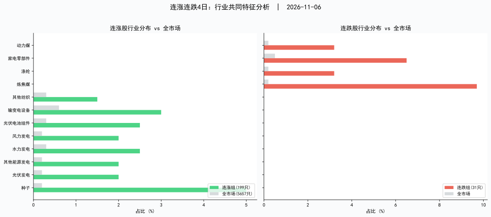

# TDX 综合分析报告

> **报告日期**：2026-11-07　·　**数据日期**：2026-11-06　·　**口径**：行情日为 TDX 库最新交易日，扩展数据覆盖日以各节注为准

---

> **摘要**：市场偏弱（置信度：中）——看多 4 条 / 看空 3 条证据；宽度：上涨 764 只 / 下跌 4797 只（较前日 -4105.0只）；⚠ 宽度否决（详见第七节）；行情 2026-11-06｜扩展数据 2026-11-04。

---

## 一、宽度趋势

近2日上涨家数减少4105只（前日4869→当日764），弱势（当日 764涨/4797跌；近3日均值 3455/2096 为「偏强」，方向背离，以当日为准）。

---

## 二、行业热点

领涨: 卫浴电器(+5.4%)、种子(+4.6%)、其他养殖(+3.2%)；领跌: PCB(-5.8%)、光纤光缆(-4.9%)、医疗研发外包(-4.6%)

---

## 三、资金面分析

> 融资/龙虎榜/大宗扩展数据截至 2026-11-04（非当日）

融资5921.4亿、北向持仓最大: 农业银行(601288)（季末披露）、龙虎榜机构今日买入10只

**两融杠杆结构**（2026-11-03 明细口径）：融资净买入合计 -85.8 亿（买入侧 14.8 亿 / 偿还侧 100.6 亿），净买入 311 只 / 净偿还 640 只（共 951 只）；普遍去杠杆（640/951 只净偿还，占比 67%）

- 净买入集中度：Top10 占全部净买入额 **40.2%**（分布相对均衡，总量信号代表性较好）
- 融资净买入 Top5：688825 +3.29亿、中国动力(600482) +0.45亿、大洋电机(002249) +0.33亿、淮河能源(600575) +0.32亿、潍柴动力(000338) +0.32亿
- 融资净偿还 Top3：中际旭创(300308) -19.40亿、东方财富(300059) -3.25亿、紫金矿业(601899) -2.47亿

*口径：type11=融资买入/偿还额，type12=融券卖出/偿还量，type13=两者净额（字段语义由恒等式反推并全市场验证）；已剔除 88 开头板块聚合行。明细口径与 type3 存量口径不可直接相加。*

---

## 四、持续性与结构特征

连涨3日以上股票199只(占全市场3.52%)，其中主升浪级别(中及以上)87只（超强9只、强10只）。连跌3日以上31只。 主升浪数量持平
连涨股行业偏好：种子(浓缩31.0倍)、光伏发电(浓缩12.4倍)、其他能源发电(浓缩11.3倍)
连跌股集中在：炼焦煤(浓缩59.8倍)、涤纶(浓缩15.3倍)、家电零部件(浓缩14.2倍)

---

## 五、资金总量规律

> 分类型数据源，更新截止日各异：type3融资/4大宗/5增减持/8·9龙虎榜至 2026-11-03/2026-11-04/2026-11-03/2026-11-04；type16总市值/21股息率/10调研/33跌停至 2026-11-04/2026-11-04；type47资金流向止 2026-11-03；type7陆股通个股行止 2024-08-16（全库含板块行至 2026-11-03，板块行语义未确认）。规律窗口起点 2025-09-11（type3日历近 250 日）；未来收益由 market_data 日线（至 2026-11-06）计算。
> 规律口径：各指标当日值分五分位（Q1最低→Q5最高），展示各组未来5日全市场等权超额收益（相对全期均值）。

- **融资净买入**：-458.51亿（2026-11-03，历史分位 P2，该分位组未来5日平均超额 +1.10%）
  规律验证：Q1→Q5 未来5日超额：+1.10%→+0.30%→+0.70%→-2.00%→-0.10%（未见单调·效力偏弱，样本50日，每组约10日）
  ↳ 统计效力：组间极差 3.05pct vs 两组均值差标准误 1.29pct（2.37 倍）——差异未明显超出噪声，方向仅供参考；但每组仅约 10 个观测（<15），单组均值抽样波动大，结论降级为仅供参考
- **大宗交易总额**：+2.12亿（2026-11-03，历史分位 P31，该分位组未来5日平均超额 -0.20%）
  规律验证：Q1→Q5 未来5日超额：+0.60%→-0.20%→+0.30%→-0.40%→-0.40%（未见单调·效力偏弱，样本242日，每组约47日）
  ↳ 统计效力：组间极差 1.08pct vs 两组均值差标准误 0.58pct（1.86 倍）——差异未明显超出噪声，方向仅供参考
- **大宗平均折溢价**：-3.63%（2026-11-03，历史分位 P80，该分位组未来5日平均超额 -0.20%）
  规律验证：Q1→Q5 未来5日超额：+0.60%→-0.20%→-0.10%→-0.10%→-0.20%（未见单调·效力偏弱，样本242日，每组约48日）
  ↳ 统计效力：组间极差 0.83pct vs 两组均值差标准误 0.59pct（1.41 倍）——差异未明显超出噪声，方向仅供参考
- **龙虎榜机构净买入**：+6.99亿（2026-11-03，历史分位 P84，该分位组未来5日平均超额 -0.20%）
  规律验证：Q1→Q5 未来5日超额：-0.50%→+0.20%→+0.40%→+0.00%→-0.20%（未见单调·效力偏弱，样本243日，每组约48日）
  ↳ 统计效力：组间极差 0.87pct vs 两组均值差标准误 0.59pct（1.47 倍）——差异未明显超出噪声，方向仅供参考
- **股东增减持净额**：+0.11亿（2026-11-03，历史分位 P95，该分位组未来5日平均超额 +0.30%）；增减持成交均价较市价-13.53%（近5日金额加权）
  规律验证：Q1→Q5 未来5日超额：-0.10%→+0.20%→+0.00%→-0.40%→+0.30%（未见单调·效力偏弱，样本239日，每组约47日）
  ↳ 统计效力：组间极差 0.67pct vs 两组均值差标准误 0.58pct（1.15 倍）——差异未明显超出噪声，方向仅供参考
- **跌停家数**：0家（2026-11-06，历史分位 P0，该分位组未来5日平均超额 -0.30%）
  规律验证：Q1→Q5 未来5日超额：-0.30%→-0.00%→+0.10%→+0.00%→+0.20%（未见单调·统计效力不足，样本267日，每组约48日）
  ↳ 统计效力：组间极差 0.52pct vs 两组均值差标准误 0.58pct（0.89 倍）——差异处于噪声内，不具统计含义
- **陆股通净买入**：当日读数缺失（数据截至 2024-08-16）
  规律验证：暂无分组结论（原始序列 2204 个观测，因未来收益不可算或指标值不可分箱，进入检验的有效样本为 0）
- **主力资金净流入**：+201.64亿（2026-11-03，历史分位 P100，该分位组未来5日平均超额 +0.80%）
  规律验证：Q1→Q5 未来5日超额：-0.10%→-0.40%→-0.50%→+0.20%→+0.80%（未见单调，样本226日，每组约45日）
  ↳ 统计效力：组间极差 1.26pct vs 两组均值差标准误 0.61pct（2.06 倍）——差异超出噪声
- **机构调研热度**：700家（2026-11-04，历史分位 P100，该分位组未来5日平均超额 +0.50%）
  规律验证：Q1→Q5 未来5日超额：-0.20%→-0.80%→+0.50%→+0.10%→+0.50%（未见单调·效力偏弱，样本162日，每组约28日）
  ↳ 统计效力：组间极差 1.31pct vs 两组均值差标准误 0.78pct（1.68 倍）——差异未明显超出噪声，方向仅供参考
- 领先滞后检验：corr(指标值_t, 市场等权收益_t+k)，k>0=指标领先市场 k 日（净额/家数类用日差分、比例类用水平值）；k=0 为同期相关，不代表预测力。
  融资净买入：滞后5日相关 +0.22（不显著，Bonferroni 阈值 |r|>0.37，水平值，N=52，检验 7 个 lag）
  大宗交易总额：同期相关 +0.04（不显著，Bonferroni 阈值 |r|>0.17，日差分，N=248，检验 7 个 lag）
  大宗平均折溢价：同期相关 -0.21（校正后显著，Bonferroni 阈值 |r|>0.17，水平值，N=249，检验 7 个 lag）
  龙虎榜机构净买入：滞后3日相关 +0.09（不显著，Bonferroni 阈值 |r|>0.17，日差分，N=249，检验 7 个 lag）
  股东增减持净额：同期相关 -0.16（名义显著但校正后不显著，Bonferroni 阈值 |r|>0.17，日差分，N=245，检验 7 个 lag）
  跌停家数：同期相关 -0.41（校正后显著，Bonferroni 阈值 |r|>0.16，日差分，N=276，检验 7 个 lag）
  主力资金净流入：同期相关 -0.23（校正后显著，Bonferroni 阈值 |r|>0.18，日差分，N=232，检验 7 个 lag）
  机构调研热度：滞后3日相关 -0.21（校正后显著，Bonferroni 阈值 |r|>0.21，日差分，N=170，检验 7 个 lag）
  汇总：8 项指标中，最佳 |r| 落在 k=0（同期相关）的有 5 项；名义阈值下存在 k>0 显著领先的 1 项，经 Bonferroni 多重比较校正后仍显著的 **0 项**。同期相关不构成预测力；校正后不显著者不应作为交易依据。
- 说明：上方规律检验仅限日序列指标；回购/分红送转/配股为公告级稀疏数据，见下方事件资金小段；拟增减持（type 23/26）语义未确认，不采用。
- 股东人数下降TOP：002425(-24.2%)/605166(-18.1%)/002923(-15.7%)/301258(-11.5%)/000933(-11.0%)（伴随股价下跌，筹码集中迹象，数据截至 2026-11-02）
- **事件资金**（近30日，公告口径）：回购披露286.4亿/146起（TOP：美的集团99.4亿、五 粮 液18.0亿、兆易创新11.7亿）；分红流出195.6亿/46起（TOP：潍柴动力44.7亿、上海银行43.0亿、华泰证券16.2亿），净流入90.7亿（回购数据截至 2026-11-06，分红至 2026-11-06，配股止 2023-02-07）。
  即将实施：1起分红共0.2亿将于未来30日内除息（3013930.2亿）。
    - 健康元(600380) 分红13.0亿，占市值7.1%（特别分红级别）
    - 凯普生物(300639) 回购1.5亿，占市值4.0%（罕见大手笔）
    - 广电电气(601616) 回购1.1亿，占市值3.8%（罕见大手笔）
    - 上海银行(601229) 分红43.0亿，占市值3.6%（特别分红级别）
    - 301097(301097) 回购1.0亿，占市值3.5%（罕见大手笔）
    - 另有74起回购/分红占市值比超阈值（明细见 tdx_money_patterns.json）。
- **个股异常资金事件检验**（T+1~T+3/T+10 累计超额 vs 全市场等权，窗口 2023-08-21~2026-11-03）：
    - 大手笔回购：447 起，T+3 超额 +0.29%（胜率 50%），T+10 超额 +0.85%（胜率 46%）
    - 特别分红：188 起，T+3 超额 -0.15%（胜率 45%），T+10 超额 -0.16%（胜率 40%）
    - 配股实施：0 起（窗口内无样本，样本不足不检验）
    - 大宗溢价：1042 起，T+3 超额 -0.33%（胜率 43%），T+10 超额 -0.13%（胜率 43%）
    - 大宗折价：392 起，T+3 超额 -0.28%（胜率 43%），T+10 超额 +0.23%（胜率 42%）
    - 机构净买：207 起，T+3 超额 +1.51%（胜率 48%），T+10 超额 +1.41%（胜率 47%）
    - 机构净卖：218 起，T+3 超额 -0.84%（胜率 38%），T+10 超额 -1.08%（胜率 37%）
    - 融资激增：103280 起，T+3 超额 -0.01%（胜率 41%），T+10 超额 -0.29%（胜率 40%）
    - 事件检验结论：正向后续（均值、中位、胜率同向）：无；负向后续（同上）：特别分红、大宗溢价、机构净卖、融资激增；均值被尾部拉动或方向不一致（不作方向结论）：大手笔回购(均值+0.29%/中位-0.03%/胜率50%)、大宗折价(T+3 -0.28% vs T+10 +0.23%，方向不一致)、机构净买(均值+1.51%/中位-0.58%/胜率48%)；样本不足不下结论：配股实施(0起)（窗口重叠样本非独立，幅度为样本内描述而非显著性检验）
    - ⚠ 数据新鲜度：本段缓存键 end_date=2026-11-04，早于本报告行情日 2026-11-06，非最新一期口径
    - 口径：窗口跨除息样本按每股股息还原 798 起（0.8%），无法还原剔除 0 起；事件日盘后可得无前视；回购为轮回购累计披露口径；幅度为样本内描述、非显著性检验。

---

## 六、资金异动脉搏（实际分析 2026-11-04）

> 请求日期 2026-11-06 扩展数据未更新，实际分析 2026-11-04

市场级指标：融资余额5921.4亿（5日净变化-4.29%，去杠杆周期）；龙虎榜机构净买卖+10.7亿；大宗交易近5日9.4亿（环比前5日0.67倍）。
异动明细：

- 机构进场：300085 净买7.4亿（占龙虎榜成交100%）
- 机构进场：002811 净买4.3亿（占龙虎榜成交100%）
- 机构异动：龙虎榜净买卖+10.7亿，为近5日均值的12.1倍

**资金异动洞察**：

- 全市场融资余额5921亿，5日净变化-4.29%，去杠杆周期（1216只两日可比个股）
- 机构进场迹象：2只个股获机构净买入11.7亿（首位300085净买7.4亿、占其龙虎榜成交100%），集中在装修装饰等行业，提示机构性买入
- 机构龙虎榜净买卖+10.7亿，为近5日均值0.9亿时的12.1倍，异动放大

---

## 七、综合研判

**看多证据**：

- 涨停42只 ≥ 跌停28只，涨停效应偏多
- 连涨3日以上199只 ≥ 连跌31只，持续性结构偏多
- 量化预测看涨（评分+6.0）
- 龙虎榜机构净买入10.7亿（2只个股获净买），机构资金进场

**看空证据**：

- 下跌4797只 vs 上涨764只，市场宽度落后
- 上涨家数较前日减少4105.0只，宽度走弱
- 融资余额5日净变化超-2%，杠杆资金退潮

**结论：市场偏弱（置信度：中）**

> ⚖ 宽度否决：上涨占比仅 13.7%（764/5561），八成以上个股下跌，零散强势信号不足以支撑"偏强"判定
> 说明：证据清单为等权计数，零散强势信号（涨停数、连涨股、机构净买）在普跌日仍可能出现；当宽度达到压倒性水平时以宽度为准。

结构性机会：连涨股集中于种子等上游制造方向，回避炼焦煤等下行行业。

---

