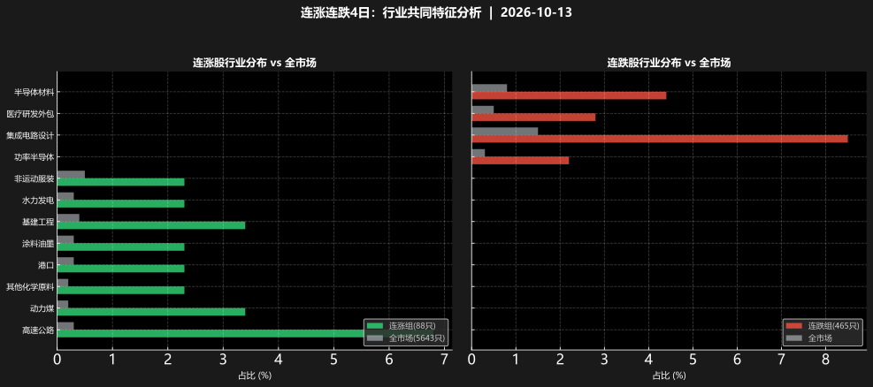

# TDX 综合分析报告 - 2026-10-16

数据日期: 2026-10-16

## 一、宽度趋势
近2日上涨家数增加558只（前日1444→当日2002），弱势 (下跌占优)。

## 二、行业热点
领涨: 碳纤维(+9.5%)、航空装备(+4.9%)、地面兵装(+4.9%)；领跌: PCB(-6.3%)、医疗研发外包(-5.1%)、诊断服务(-5.0%)

## 三、资金面分析
> 融资/龙虎榜/大宗扩展数据截至 2026-10-09（非当日）
融资3110.6亿、龙虎榜机构今日买入6只

## 四、持续性与结构特征
连涨3日以上股票31只(占全市场0.55%)，其中主升浪级别(中及以上)12只（超强3只、强2只）。连跌3日以上1444只。 连涨股减少86只；连跌股增加883只；主升浪减少53只；新出现连涨行业：大众出版、娱乐用品、厨房小家电；消失的连涨行业：高速公路、游戏、互联网广告；新出现连跌行业：其他生物制药、电池化学品、诊断试剂
连涨股行业偏好：娱乐用品(浓缩27.8倍)、动力煤(浓缩26.0倍)、大众出版(浓缩22.9倍)
连跌股集中在：电池化学品(浓缩3.2倍)、医疗研发外包(浓缩2.7倍)、诊断试剂(浓缩2.6倍)

## 五、资金总量规律
> 分类型数据源，更新截止日各异：type3融资/4大宗/5增减持/8·9龙虎榜至 2026-10-08/2026-10-09/2026-10-08/2026-10-09；type16总市值/21股息率/10调研/33跌停至 2026-10-09/2026-10-09；type47资金流向止 2026-09-30；type7陆股通个股行止 2024-08-16（全库含板块行至 2026-07-14，板块行语义未确认）。规律窗口起点 2025-08-27（type3日历近 250 日）；未来收益由 market_data 日线（至 2026-10-09）计算。
> 规律口径：各指标当日值分五分位（Q1最低→Q5最高），展示各组未来5日全市场等权超额收益（相对全期均值）。
- **融资净买入**：-204.12亿（2026-09-30，历史分位 P12，该分位组未来5日平均超额 +0.02%）
  规律验证：Q1→Q5 未来5日超额：+0.02%→-0.00%→+0.00%→-0.01%→-0.00%（未见单调，样本49日）
- **大宗交易总额**：+0.17亿（2026-10-08，历史分位 P2，该分位组未来5日平均超额 +0.01%）
  规律验证：Q1→Q5 未来5日超额：+0.01%→+0.00%→+0.00%→-0.00%→-0.01%（单调↓，样本240日）
- **大宗平均折溢价**：-10.45%（2026-10-08，历史分位 P10，该分位组未来5日平均超额 +0.01%）
  规律验证：Q1→Q5 未来5日超额：+0.01%→-0.00%→-0.00%→-0.00%→+0.00%（未见单调，样本240日）
- **龙虎榜机构净买入**：+0.86亿（2026-10-08，历史分位 P53，该分位组未来5日平均超额 +0.01%）
  规律验证：Q1→Q5 未来5日超额：-0.01%→+0.00%→+0.01%→+0.00%→-0.00%（未见单调，样本241日）
- **股东增减持净额**：+0.09亿（2026-10-08，历史分位 P95，该分位组未来5日平均超额 +0.01%）；增减持成交均价较市价+0.04%（近5日金额加权）
  规律验证：Q1→Q5 未来5日超额：-0.00%→+0.00%→-0.00%→-0.00%→+0.01%（未见单调，样本237日）
- **跌停家数**：4家（2026-10-09，历史分位 P35，该分位组未来5日平均超额 +0.00%）
  规律验证：Q1→Q5 未来5日超额：-0.00%→+0.00%→+0.00%→-0.01%→+0.01%（未见单调，样本258日）
- **陆股通净买入**：+5.58亿（2024-08-16，历史分位 P84，该分位组未来5日平均超额 +0.00%）（数据截至 2024-08-16）
  规律验证：Q1→Q5 未来5日超额：-0.00%→+0.00%→+0.01%→-0.00%→+0.00%（未见单调，样本2204日）
- **主力资金净流入**：+2.22亿（2026-09-30，历史分位 P64，该分位组未来5日平均超额 +0.00%）
  规律验证：Q1→Q5 未来5日超额：-0.00%→-0.01%→-0.00%→+0.00%→+0.01%（未见单调，样本214日）
- **机构调研热度**：380家（2026-10-09，历史分位 P89，该分位组未来5日平均超额 +0.02%）
  规律验证：Q1→Q5 未来5日超额：-0.01%→-0.02%→+0.00%→+0.00%→+0.02%（未见单调，样本148日）
- 领先滞后检验：corr(指标值_t, 市场等权收益_t+k)，k>0=指标领先市场 k 日（净额/家数类用日差分、比例类用水平值）；k=0 为同期相关，不代表预测力。
  融资净买入：滞后5日相关 +0.28（显著，水平值，N=52）
  大宗交易总额：同期相关 +0.06（不显著，日差分，N=248）
  大宗平均折溢价：同期相关 -0.20（显著，水平值，N=249）
  龙虎榜机构净买入：滞后3日相关 +0.11（不显著，日差分，N=249）
  股东增减持净额：同期相关 -0.17（显著，日差分，N=245）
  跌停家数：同期相关 -0.45（显著，日差分，N=267）
  陆股通净买入：滞后1日相关 -0.07（显著，日差分，N=2203）
  主力资金净流入：同期相关 -0.23（显著，日差分，N=221）
  机构调研热度：滞后3日相关 -0.22（显著，日差分，N=158）
  汇总：9 指标中 2 项对市场收益存在显著线性领先（|r|>1.96/√N）；线性相关≠可交易规律，显著项亦需样本外验证。
- 说明：上方规律检验仅限日序列指标；回购/分红送转/配股为公告级稀疏数据，见下方事件资金小段；拟增减持（type 23/26）语义未确认，不采用。
- 股东人数下降TOP：002425(-24.2%)/605166(-18.1%)/002923(-15.7%)/605098(-14.6%)/300255(-13.0%)（伴随股价下跌，筹码集中迹象，数据截至 2026-09-30）
- **事件资金**（近30日，公告口径）：回购披露167.2亿/50起（TOP：美的集团99.4亿、格力电器10.8亿、泰格医药8.2亿）；分红流出89.0亿/39起（TOP：恒逸石化33.6亿、中信特钢10.1亿、天孚通信5.5亿），净流入78.1亿（回购数据截至 2026-10-10，分红至 2026-10-08，配股止 2023-02-07）。
  即将实施：8起分红共27.3亿将于未来30日内除息（丽珠集团9.1亿、华峰化学7.4亿、华润三九6.9亿）。
  - 恒逸石化(000703) 分红33.6亿，占市值5.2%（特别分红级别）
  - 301097(301097) 回购1.0亿，占市值3.5%（罕见大手笔）
  - 富森美(002818) 分红3.0亿，占市值3.4%（特别分红级别）
  - 海 利 得(002206) 回购1.6亿，占市值2.8%（罕见大手笔）
  - 物产金轮(002722) 回购0.6亿，占市值2.1%（罕见大手笔）
  - 另有26起回购/分红占市值比超阈值（明细见 tdx_money_patterns.json）。
- **个股异常资金事件检验**（T+1~T+3/T+10 累计超额 vs 全市场等权，窗口 2023-08-04~2026-10-08）：
  - 大手笔回购：746 起，T+3 超额 -0.08%（胜率 46%），T+10 超额 -0.65%（胜率 40%）
  - 特别分红：331 起，T+3 超额 +0.14%（胜率 50%），T+10 超额 -0.04%（胜率 46%）
  - 配股实施：0 起（窗口内无样本，样本不足不检验）
  - 大宗溢价：2056 起，T+3 超额 -0.20%（胜率 45%），T+10 超额 -0.20%（胜率 44%）
  - 大宗折价：514 起，T+3 超额 -0.47%（胜率 41%），T+10 超额 -0.17%（胜率 41%）
  - 机构净买：201 起，T+3 超额 +1.91%（胜率 51%），T+10 超额 +1.61%（胜率 48%）
  - 机构净卖：218 起，T+3 超额 -0.95%（胜率 41%），T+10 超额 -0.59%（胜率 36%）
  - 融资激增：103499 起，T+3 超额 -0.11%（胜率 42%），T+10 超额 -0.23%（胜率 40%）
  - 事件检验结论：正向后续：机构净买；负向后续：大手笔回购、大宗溢价、大宗折价、机构净卖、融资激增；样本不足不下结论：配股实施(0起)（窗口重叠样本非独立，幅度为样本内描述而非显著性检验）
  - 口径：窗口跨除息样本按每股股息还原 1000 起（0.9%），无法还原剔除 0 起；事件日盘后可得无前视；回购为轮回购累计披露口径；幅度为样本内描述、非显著性检验。

## 六、资金异动脉搏（实际分析 2026-10-09）
> 请求日期 2026-10-16 扩展数据未更新，实际分析 2026-10-09
市场级指标：融资余额3110.6亿（5日净变化-2.53%，去杠杆周期）；龙虎榜机构净买卖-2.7亿；大宗交易近5日4.0亿（环比前5日0.36倍）。
异动明细：
- 机构撤退：300413 净卖1.2亿
- 机构撤退：002058 净卖0.1亿
**资金异动洞察**：
- 全市场融资余额3111亿，5日净变化-2.53%，去杠杆周期（553只两日可比个股）
- 机构撤退迹象：2只个股遭机构净卖出1.2亿（首位300413净卖1.2亿），集中在视频音频媒体等行业，提示获利了结或避险

## 七、综合研判
**看多证据**：
- 上涨家数较前日增加558.0只，宽度改善
- 量化预测看涨（评分+5.0）
**看空证据**：
- 下跌3460只 vs 上涨2002只，市场宽度落后
- 跌停36只 > 涨停22只，亏钱效应压制情绪
- 连跌3日以上1444只 > 连涨31只，持续性结构偏空
- 龙虎榜机构净卖出2.7亿（2只个股遭净卖），机构资金撤退
- 融资余额5日净变化超-2%，杠杆资金退潮
**结论：市场偏弱（置信度：中）** ⚠ 信号分歧：宽度证据偏空但量化预测看涨，方向待确认
资金总量信号：8/9项总量指标的当日分位组历史未来5日超额为正，对结论形成支撑。
结构性机会：连涨股集中于娱乐用品等上游制造方向，回避电池化学品等下行行业。

