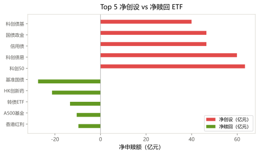
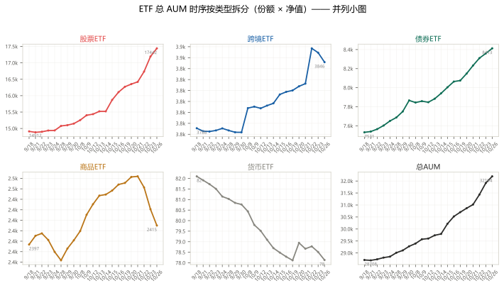
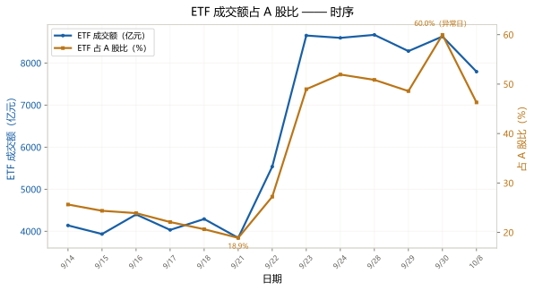
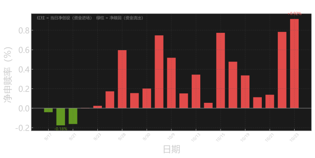

# ETF 申赎与成交额占比分析报告

数据期间：2026-09-02 → 2026-10-08（21 个交易日） · 覆盖 898 只 ETF（全市场清单 1742 只；份额明细仅上交所口径——深交所份额接口暂不可用） · 数据来源：akshare · **⚠ 数据滞后 4 个自然日**

## 核心指标

| 指标 | 数值 |
|:---|---:|
| 覆盖 ETF 数 | 898 |
| 期间净申赎合计 | +1357 亿（统计窗口 2026-09-02 → 2026-10-08，21 个交易日） |
| 净创设 / 净赎回 | 430 只 / 371 只 |
| 当前日 ETF 占 A 股成交比 | 46.30%（异常日） |
| ETF 总 AUM（期末） | 3.10 万亿 |

---

## 1. Top 5 净创设 vs 净赎回 ETF

**净创设 Top5**

| 排名 | ETF | 净申赎 |
|---:|:---|---:|
| 1 | 科创50 | +145 亿 |
| 2 | 短融ETF | +91 亿 |
| 3 | 科创债易 | +72 亿 |
| 4 | 信用债 | +60 亿 |
| 5 | 30年国债 | +55 亿 |

**净赎回 Top5**

| 排名 | ETF | 净申赎 |
|---:|:---|---:|
| 1 | HK创新药 | -29 亿 |
| 2 | 煤炭ETF | -27 亿 |
| 3 | 基准国债 | -24 亿 |
| 4 | A500基金 | -19 亿 |
| 5 | 中证2000 | -13 亿 |

> 净创设与净赎回 Top5 轧差反映一级市场份额增减方向。

---

## 2. ETF 总 AUM 时序按类型拆分（份额 × 净值）—— 并列小图

| 类型 | 期初 AUM（亿） | 期末 AUM（亿） | 变动（亿） |
|:-----|--------------:|--------------:|----------:|
| 股票ETF | 15860 | 16452 | +592 |
| 跨境ETF | 3967 | 4033 | +66 |
| 债券ETF | 7149 | 7836 | +687 |
| 商品ETF | 2510 | 2573 | +63 |
| 货币ETF | 79 | 81 | +2 |

> 每个类型独立坐标，走势一目了然。股票 ETF 占总 AUM 的 53%。

---

## 3. ETF 成交额占 A 股比 —— 时序

| 指标 | 当前日数值 | 期间范围 |
|:-----|----------:|---------:|
| ETF 成交额 | 7795 亿元 | 3591 ~ 11074 亿 |
| A 股成交额 | 16836 亿元 | 14394 ~ 20791 亿 |
| **ETF 占 A 股比** | **46.30%**（异常日） | 19.33% ~ 37.79% |
| 期间均值 | **24.08%** | 已剔除 13 个比值异常日 |

> 比值 >40% 的交易日视为分母异常（分母缺失被填充掩盖，或 ETF 成交额口径跳变），已从范围/均值统计中剔除，明细保留在图中。ETF 成交额 = 全市场 ETF 逐只成交额累加；A 股成交额 = 上交所 + 深交所股票成交金额合计。

---

## 4. ETF 每日净申赎率时序（Δ份额 / 前日总份额）

| 阶段 | 特征 |
|:-----|:-----|
| 期间峰值 | 10/8 触顶 +0.75% |
| 期间谷值 | 9/15 触底 -0.25% |
| 最新日 | 0.75%，21 个交易日中 7 天净赎回 |

> 红柱 = 当日净创设（资金进场），绿柱 = 净赎回（资金流出）。

---

## 5. 关键发现

1. **股票 ETF 是主体。** 694 只股票 ETF 占 ETF 总 AUM 的 53%，期间净赎回 547 亿，占全部净赎回的 60%。
2. **资金月度节奏。** 期间净申赎合计 +1357 亿（统计窗口 2026-09-02 → 2026-10-08，21 个交易日逐日 Δ份额×净值累计）；较早月（2026-09）累计 +1225 亿，最近月（2026-10）累计 +133 亿。分月合计 +1357 亿，与期间合计核验一致。
3. **资金在不同大类换仓。** 债券 ETF +687 亿、商品 ETF +63 亿，与股票 ETF 的 +547 亿形成对比。
4. **净创设前二。** 科创50 (+145亿)、短融ETF (+91亿) 是期间净创设主力。
5. **ETF 占 A 股成交比。** 期间均值 24.1%（剔除 13 个比值 >40% 的异常日后），当前日 46.3%（ETF 7795 亿 / A 股 16836 亿）。

---

*报告生成时间：动态 · 数据来源：akshare · 脚本：fund_analysis/*
