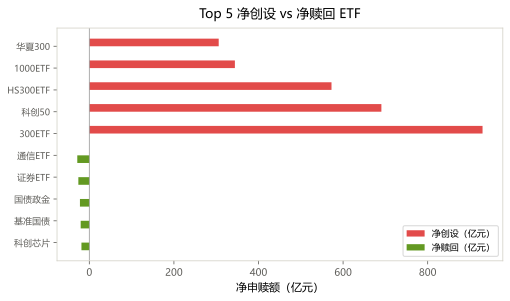
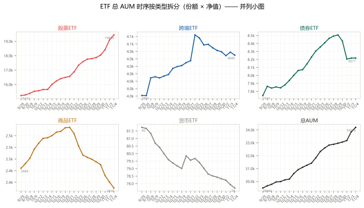
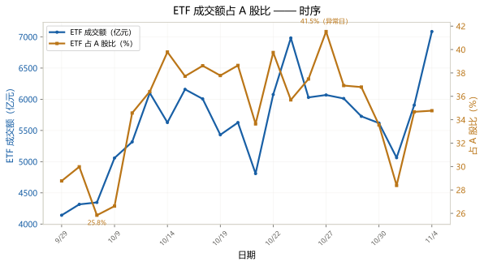
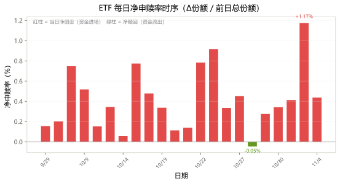

# ETF 申赎与成交额占比分析报告

数据期间：2026-09-29 → 2026-11-04（22 个交易日） · 覆盖 915 只 ETF（全市场清单 1775 只；份额明细仅上交所口径——深交所份额接口暂不可用） · 数据来源：份额 akshare（上交所口径）· 成交额 TDX 本地库

> **摘要**：期间净申赎 +4790 亿（净创设 527 只 / 净赎回 321 只），资金净流入（申赎口径）；股票 ETF 占总 AUM 57%；股票 ETF 占 A 股成交比当前 9.9%（全品类参考口径 34.6%）；最新日净申赎率 +0.44%。

## 核心指标

| 指标 | 数值 |
|:---|---:|
| 覆盖 ETF 数 | 915 |
| 期间净申赎合计 | +4790 亿（统计窗口 2026-09-29 → 2026-11-04，22 个交易日） |
| 净创设 / 净赎回 | 527 只 / 321 只 |
| 当前日股票 ETF 占 A 股成交比 | 9.88%（主口径） |
| 当前日全品类 ETF 占 A 股成交比 | 34.77%（参考口径） |
| ETF 总 AUM（期末） | 3.42 万亿 |

---

## 1. Top 5 净创设 vs 净赎回 ETF

**净创设 Top5**

| 排名 | ETF | 净申赎 |
|---:|:---|---:|
| 1 | 300ETF | +930 亿 |
| 2 | 科创50 | +691 亿 |
| 3 | HS300ETF | +573 亿 |
| 4 | 1000ETF | +344 亿 |
| 5 | 华夏300 | +306 亿 |

**净赎回 Top5**

| 排名 | ETF | 净申赎 |
|---:|:---|---:|
| 1 | 通信ETF | -28 亿 |
| 2 | 证券ETF | -26 亿 |
| 3 | 国债政金 | -22 亿 |
| 4 | 基准国债 | -20 亿 |
| 5 | 科创芯片 | -19 亿 |

> 净创设与净赎回 Top5 轧差反映一级市场份额增减方向。

---

## 2. ETF 总 AUM 时序按类型拆分（份额 × 净值）—— 并列小图

| 类型 | 期初 AUM（亿） | 期末 AUM（亿） | 变动（亿） |
|:-----|--------------:|--------------:|----------:|
| 股票ETF | 15231 | 19449 | +4218 |
| 跨境ETF | 3991 | 4045 | +54 |
| 债券ETF | 7747 | 8217 | +470 |
| 商品ETF | 2444 | 2410 | -34 |
| 货币ETF | 82 | 78 | -4 |

> 每个类型独立坐标，走势一目了然。股票 ETF 占总 AUM 的 57%。

---

## 3. ETF 成交额占 A 股比 —— 时序

| 指标 | 当前日数值 | 期间范围 |
|:-----|----------:|---------:|
| 全品类 ETF 成交额 | 7085 亿元 | 4141 ~ 7085 亿 |
| 其中股票 ETF 成交额 | 2013 亿元（占 ETF 总成交 28%） | — |
| A 股成交额 | 20375 亿元 | 14143 ~ 20375 亿 |
| **股票 ETF 占 A 股比（主口径）** | **9.88%** | 期间均值 7.45% |
| 全品类 ETF 占 A 股比（参考） | 34.77% | 25.84% ~ 39.79%，均值 34.59% |

> **两个口径不可混用**：主口径分子只含股票 ETF（与分母 A 股股票同物）；参考口径分子是全品类 ETF 成交额（含债券 ETF、货币 ETF、跨境/商品 ETF 及 LOF），分母仍是 A 股股票成交额，因此数值天然偏高（当前 34.8% vs 主口径 9.9%），**不能解读为"股票 ETF 占 A 股成交三分之一"**。股票 ETF 成交额覆盖率 100%（711/711 只可与份额清单匹配）。
>
> 比值 >40% 的交易日视为分母异常（分母缺失被填充掩盖，或 ETF 成交额口径跳变），已从参考口径的范围/均值统计中剔除，明细保留在图中。ETF 成交额 = 逐只 ETF 成交额累加；A 股成交额 = 上交所 + 深交所股票成交金额合计。

---

## 4. ETF 每日净申赎率时序（Δ份额 / 前日总份额）

| 阶段 | 特征 |
|:-----|:-----|
| 期间峰值 | 11/3 触顶 +1.17% |
| 期间谷值 | 10/28 触底 -0.05% |
| 最新日 | 0.44%，22 个交易日中 1 天净赎回 |

> 红柱 = 当日净创设（资金进场），绿柱 = 净赎回（资金流出）。

---

## 5. 关键发现

1. **股票 ETF 是主体。** 704 只股票 ETF 占 ETF 总 AUM 的 57%，期间**净申购 4234 亿**，相当于期间净申赎总额（+4790 亿）的 88%。若只看净赎回产品（合计 453 亿），股票 ETF 贡献 224 亿、占 49%——这是赎回侧口径，与上句的净额口径不可混用。
2. **资金月度节奏。** 期间净申赎合计 +4790 亿（统计窗口 2026-09-29 → 2026-11-04，22 个交易日逐日 Δ份额×净值累计）；较早月（2026-09）累计 +261 亿，最近月（2026-11）累计 +1139 亿。分月合计 +4790 亿，与期间合计核验一致。
3. **资金在不同大类换仓。** 债券 ETF +470 亿、商品 ETF -34 亿，与股票 ETF 的 +4234 亿形成对比。
4. **净创设前二。** 300ETF (+930亿)、科创50 (+691亿) 是期间净创设主力。
5. **ETF 占 A 股成交比（两个口径）。** 主口径 = 股票 ETF / A 股股票成交额：当前日 9.9%（2013 亿 / 20375 亿），期间均值 7.4%。参考口径 = 全品类 ETF / A 股股票成交额：当前日 34.8%、期间均值 34.6%（已剔除 1 个比值 >40% 的异常日）。两者差异来自分子范围，非数据错误。

---

*报告生成时间：2026-11-07 18:15 · 数据来源：份额 akshare（上交所口径）· 成交额 TDX 本地库 · 脚本：fund_analysis/*
